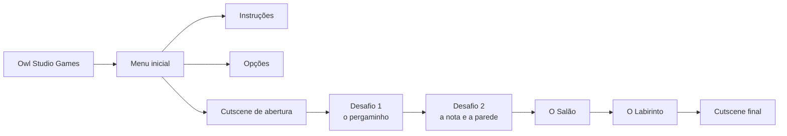

<div align="center">


# Let's Play

**Um jogo de terror e quebra-cabeças em pixel art, feito em Construct 2.**

Projeto do grupo **Smaug** · Jogos Digitais · 1º semestre de 2021 — Fatec Carapicuíba


<br>

<a href="https://devrobson.itch.io/lets-play"></a>

</div>

---

## 📖 Sobre o jogo

> *"Nos conhecemos do passado, meu velho amigo... lembre-se: conheço seus pecados."*

**Fred** acorda vendado em uma masmorra escura, sem saber como chegou ali. Uma voz misteriosa avisa que ele só sairá com vida se resolver todos os desafios do lugar — e que, ao longo do caminho, vai descobrir **o real motivo de estar preso** e **pagar pelos seus pecados**.

Entre armadilhas, salas trancadas, pergaminhos enigmáticos e bilhetes deixados pelo sequestrador, Fred precisa desvendar quem está por trás de tudo isso e qual segredo do passado o trouxe até aqui.

<div align="center">


&nbsp;&nbsp;&nbsp;&nbsp;


<sub><b>Fred</b>, o protagonista &nbsp;·&nbsp; <b>???</b>, o anfitrião misterioso</sub>

</div>

## ⬇️ Baixar e jogar

O jogo está disponível no **itch.io**:

👉 **[devrobson.itch.io/lets-play](https://devrobson.itch.io/lets-play)**

Baixe o arquivo `Let's Play 1JDM.rar`, extraia o conteúdo e abra o executável do jogo.

## 🎮 Como jogar

| Tecla | Ação |
| :---: | --- |
| <kbd>↑</kbd> <kbd>↓</kbd> <kbd>←</kbd> <kbd>→</kbd> | Movimentar o Fred |
| <kbd>Espaço</kbd> | Interagir com objetos (alavancas, notas, pergaminhos, portas) |
| <kbd>Espaço</kbd> | Fechar cartas e notas abertas |
| Mouse / toque | Navegar pelos menus |

Sempre que o símbolo **LET'S** aparecer sobre o Fred, significa que ele pode interagir com o item à sua frente — seja para avançar no jogo, seja para descobrir mais da história.

<div align="center">

</div>

## 🗝️ Estrutura do jogo



- **Cutscene de abertura** — Fred acorda vendado e ouve a voz que vai guiá-lo (e atormentá-lo).
- **Desafio 1** — um pergaminho traz pistas sobre dragões e estrelas; um único erro pode ser fatal.
- **Desafio 2** — bilhetes do sequestrador e uma passagem escondida na parede.
- **O Salão** — a pedra que abre caminho para a última etapa.
- **O Labirinto** — o desafio final antes do confronto.
- **Cutscene final** — a verdade sobre o passado de Fred é revelada.

### ⚠️ Perigos

Espinhos que saem do chão, armadilhas de fogo, armadilhas que empurram e buracos no piso. Cair em uma delas leva direto à tela de **Game Over**.

<div align="center">

</div>

## ▶️ Como abrir e rodar o projeto

O projeto foi salvo com o **Construct 2 (release 244)**, que roda no Windows.

1. Clone ou baixe este repositório:
   ```bash
   git clone https://github.com/egcrobson/SMAUG---1-Semestre---Let-s-Play.git
   ```
2. Abra o arquivo **`Let's Play.caproj`** no Construct 2.
3. Pressione <kbd>F5</kbd> (*Run layout*) para jogar no navegador.
4. Para gerar uma versão jogável, use **File → Export project → HTML5 website**.

## 📁 Estrutura do repositório

```
├── Let's Play.caproj   # Arquivo principal do projeto (abra no Construct 2)
├── Layouts/            # Telas e fases (menu, desafios, cutscenes)
├── Event sheets/       # Lógica de cada tela (eventos do Construct 2)
├── Animations/         # Sprites e animações em pixel art
├── Textures/           # Fontes em sprite
└── Files/              # Sons, músicas e ícones
```

## 🛠️ Tecnologias

- **[Construct 2](https://www.construct.net/en/construct-2/manuals/construct-2)** — engine e editor do jogo
- **HTML5 + WebGL** — plataforma de exportação
- Comportamentos usados: *8 Direction*, *Solid*, *Scroll To*, *Turret*
- Plugins usados: *Keyboard*, *Mouse*, *Touch*, *Audio*, *Array*, *Function*, *Sprite Font*

## 👥 Equipe

Desenvolvido pela **Owl Studio Games** — grupo **Smaug**, turma da manhã do curso de **Jogos Digitais** da **Fatec Carapicuíba**.

| Nome | Links |
| --- | --- |
| **Robson dos Santos Silva** | [GitHub](https://github.com/egcrobson) · [itch.io](https://devrobson.itch.io) · [Linktree](https://linktr.ee/devrobson) |
| **Leonardo Souza de Oliveira** | — |

<div align="center">

</div>

## 🎵 Créditos

- **Músicas:** faixas de **Alexander Ehlers** — *Great Mission*, *Spacetime*, *Twists* e *Waking the Devil*.
- **Efeitos sonoros:** passos, tochas, alavancas, espinhos, coruja e outros, na pasta [`Files/`](Files).

## 🏫 Contexto acadêmico

Proposta de um *escape room* desenvolvida no **1º semestre de 2021** do curso de **Jogos Digitais** da **Fatec Carapicuíba**, pelo grupo **Smaug**.

---

<div align="center">
<sub>Feito com ☕ e muitos sustos por Owl Studio Games</sub>
</div>
